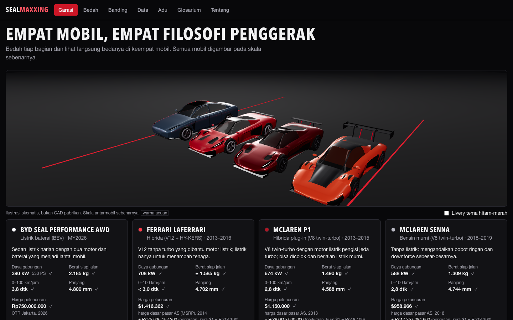
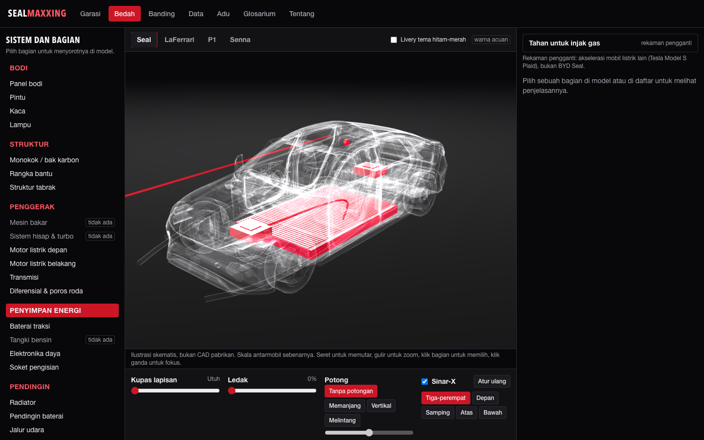
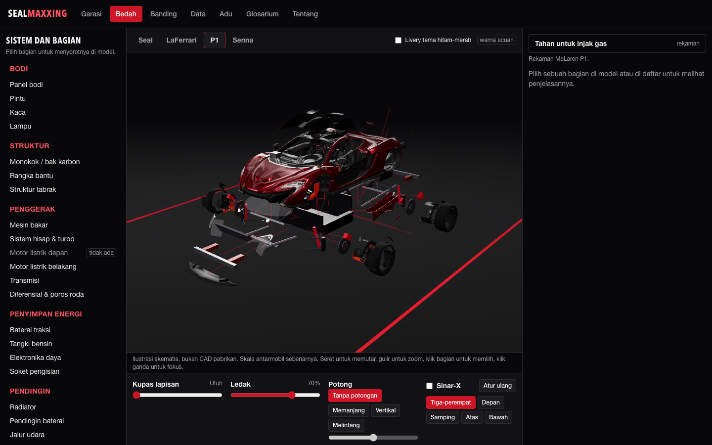
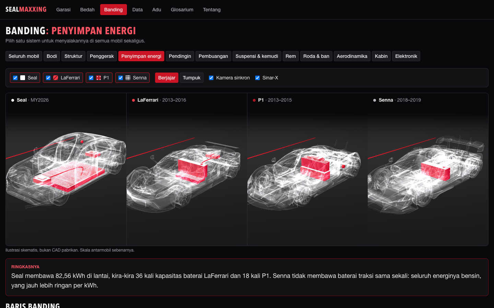
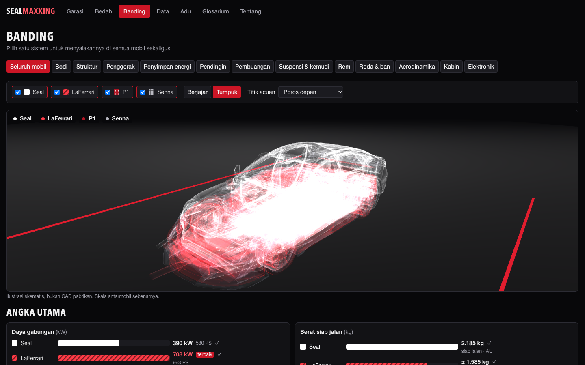
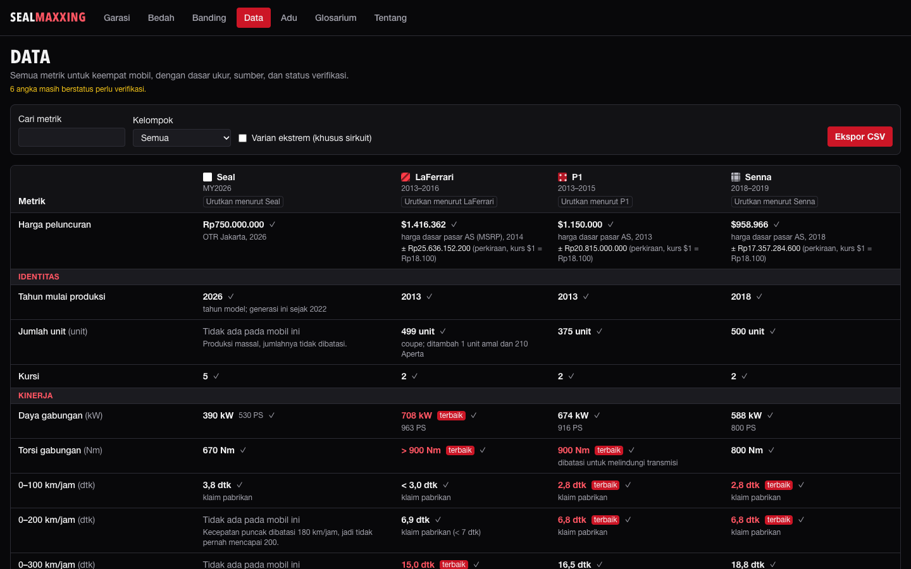
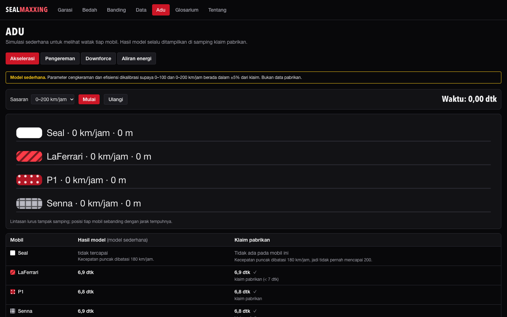
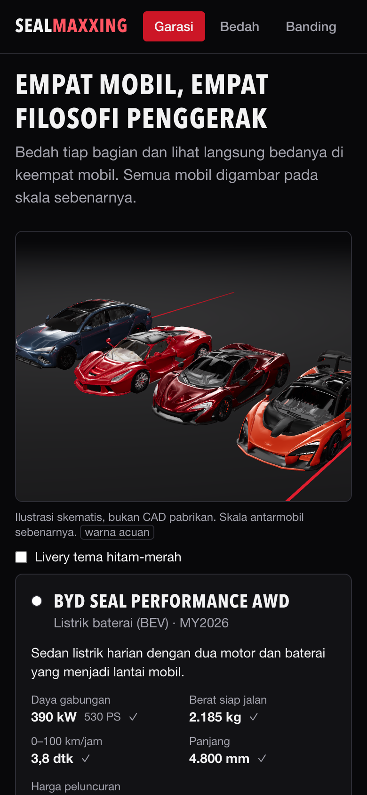
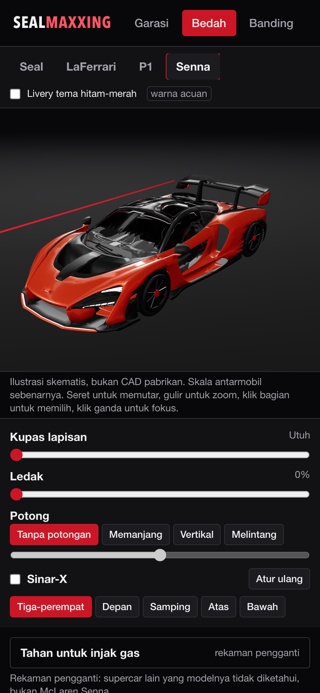

# SealMaxxing

[](https://github.com/Orls967/SealMaxxing/actions/workflows/deploy.yml)

Aplikasi web 3D berbahasa Indonesia untuk membedah dan membandingkan empat mobil dengan empat
filosofi penggerak: listrik baterai, hibrida V12, hibrida plug-in V8, dan bensin murni.
Penjelasan sebuah bagian selalu tampil di samping padanannya di tiga mobil lain. Berjalan
sepenuhnya di peramban: tanpa backend, tanpa akun, tanpa API key.

**Demo: https://orls967.github.io/SealMaxxing/**



|                                                                  |                                                                  |
| ---------------------------------------------------------------- | ---------------------------------------------------------------- |
|       |           |
|  |  |
|        |             |

Tampilan ponsel:

|                                                         |                                                       |
| ------------------------------------------------------- | ----------------------------------------------------- |
|  |  |

> Bukan produk resmi. Tidak berafiliasi dengan BYD, Ferrari, atau McLaren. Model 3D adalah
> ilustrasi buatan sendiri, bukan CAD pabrikan; skala antarmobil sebenarnya.

## Daftar isi

- [Empat mobil](#empat-mobil)
- [Halaman](#halaman)
- [Cara memakai](#cara-memakai)
- [Aturan data](#aturan-data)
- [Batasan](#batasan)
- [Menjalankan](#menjalankan)
- [Struktur](#struktur)
- [Deploy](#deploy)
- [Sumber dan kredit](#sumber-dan-kredit)

## Empat mobil

| Mobil                    | Jenis                         | Produksi  | Daya gabungan   | Berat siap jalan | 0–100 km/jam | Harga peluncuran            | Perkiraan rupiah   |
| ------------------------ | ----------------------------- | --------- | --------------- | ---------------- | ------------ | --------------------------- | ------------------ |
| BYD Seal Performance AWD | Listrik baterai               | MY2026    | 390 kW (530 PS) | 2.185 kg         | 3,8 dtk      | Rp750.000.000 (OTR Jakarta) | tidak dikonversi   |
| Ferrari LaFerrari        | Hibrida V12 + HY-KERS         | 2013–2016 | 708 kW (963 PS) | ± 1.585 kg       | < 3,0 dtk    | $1.416.362 (AS, 2014)       | ± Rp25.636.152.200 |
| McLaren P1               | Hibrida plug-in V8 twin-turbo | 2013–2015 | 674 kW (916 PS) | 1.490 kg         | 2,8 dtk      | $1.150.000 (AS, 2013)       | ± Rp20.815.000.000 |
| McLaren Senna            | Bensin V8 twin-turbo          | 2018–2019 | 588 kW (800 PS) | 1.309 kg         | 2,8 dtk      | $958.966 (AS, 2018)         | ± Rp17.357.284.600 |

Harga adalah harga peluncuran dalam mata uang aslinya. Rupiah untuk harga dolar adalah
perkiraan dengan kurs tetap $1 = Rp18.100 (ditetapkan 14 November 2026), dihitung di
`src/lib/price.ts`, bukan kurs pasar. Karena tahun dan pasarnya berbeda, harga tidak dipakai
untuk menentukan pemenang.

## Halaman

| Rute                        | Halaman   | Isi                                                                                         |
| --------------------------- | --------- | ------------------------------------------------------------------------------------------- |
| `#/`                        | Garasi    | Empat mobil berjajar pada skala sebenarnya, angka kunci, harga, suara, pintu ke semua modul |
| `#/bedah/:carId`            | Bedah     | Kupas lapisan, ledak, potong, sinar-X; panel bagian dengan strip banding ke tiga mobil lain |
| `#/banding/:systemId?`      | Banding   | 2–4 mobil berjajar atau ditumpuk, kamera sinkron, satu sistem disorot di semua mobil        |
| `#/data`                    | Data      | Tabel induk, grafik batang/radar/sebar, varian khusus sirkuit, daftar sumber, ekspor CSV    |
| `#/adu`                     | Adu       | Simulasi akselerasi, pengereman, downforce terhadap kecepatan, dan aliran energi            |
| `#/glosarium` · `#/tentang` | Pendukung | Istilah teknis; metode, batasan, kredit, dan daftar angka yang belum terverifikasi          |

## Cara memakai

- **Model 3D:** seret untuk memutar, gulir untuk zoom, klik bagian untuk memilih, klik ganda
  untuk fokus. Daftar sistem di sisi kiri adalah padanan keyboard untuk semua yang bisa diklik.
- **Alat bedah:** penggeser kupas dan ledak, bidang potong pada tiga sumbu, sakelar sinar-X,
  dan lima preset kamera. Semuanya bisa digabung.
- **Suara:** tahan tombol "Tahan untuk injak gas" (atau tahan Spasi/Enter) untuk mendengar
  mobil digas; lepas untuk kembali ke putaran rendah. Suaranya sintetis, lihat
  [Batasan](#batasan).
- **Warna:** bawaan mengikuti warna acuan tiap mobil; sakelar "Livery tema hitam-merah"
  mengganti keempatnya ke livery tema.
- **Tautan yang bisa dibagikan:** seluruh keadaan tampilan tersimpan di hash URL, misalnya
  `#/bedah/p1?ex=70` atau `#/banding/energy?xray=1`.

## Aturan data

- Setiap angka punya sumber (`src/content/sources.ts`, tampil di halaman Data). Yang belum
  dicek ke sumber ditandai **perlu verifikasi**.
- Bagian yang tidak ada pada sebuah mobil ditulis "tidak ada pada mobil ini" beserta
  alasannya, bukan angka nol.
- Pemenang hanya ditandai bila dasar ukurnya sama. Berat siap jalan tidak dibandingkan dengan
  berat kering, jarak listrik selalu disertai siklus ujinya (WLTP, NEDC), dan downforce selalu
  disertai kecepatan ukurnya. Dasar berbeda → kedua angka tampil dengan labelnya, tanpa
  pemenang.
- Metrik turunan (daya per ton, porsi daya listrik, dan lainnya) dihitung di kode, tidak
  disimpan.

**Status verifikasi (14 November 2026).** Harga, dimensi, berat, daya, cakram, ban, dan pelek
sudah dicek ke sumber. Enam angka masih berlabel "perlu verifikasi": tingkat transmisi Seal,
downforce LaFerrari (± 360 kg pada 200 km/jam), putaran maksimum mesin P1 dan Senna, serta
tangki bensin P1 dan Senna. Daftar terkini selalu ada di halaman Tentang.

## Batasan

Aplikasi ini alat belajar, bukan lembar data pabrikan.

- **Model 3D.** Dibangun secara prosedural dari dimensi yang dipublikasikan. Bodi adalah
  pendekatan bentuk; komponen dalam (mesin, baterai, sasis) adalah ilustrasi skematis. Yang
  dijaga benar: skala antarmobil, jumlah silinder, serta ukuran dan letak kasar komponen utama.
- **Suara.** Dibangkitkan di peramban dengan Web Audio, tanpa berkas rekaman. Nadanya dihitung
  dari jumlah silinder dan putaran maksimum tiap mesin; Seal hanya berdengung seperti motor
  listrik. Ini ilustrasi, bukan rekaman mobil aslinya.
- **Simulasi.** Model fisika sederhana yang dikalibrasi supaya 0–100 dan 0–200 km/jam berada
  dalam ±5% dari klaim pabrikan; hasilnya selalu tampil di samping klaimnya. Kurva downforce
  adalah perkiraan dari satu titik klaim.
- **Tanpa WebGL.** Halaman tetap berfungsi dengan gambar statis sebagai pengganti model 3D.

## Menjalankan

Butuh Node.js 24 atau lebih baru.

```bash
npm install
npm run dev        # http://localhost:5173
```

| Perintah                                                 | Guna                                          |
| -------------------------------------------------------- | --------------------------------------------- |
| `npm run build`                                          | `tsc --noEmit` lalu build produksi ke `dist/` |
| `npm run preview`                                        | Menyajikan `dist/`                            |
| `npm run lint` · `npm run typecheck`                     | ESLint · TypeScript                           |
| `npm run test`                                           | Unit, konten, dan komponen (Vitest)           |
| `npm run e2e`                                            | Playwright terhadap build produksi            |
| `npm run check:content`                                  | Kelengkapan konten dan sumber                 |
| `node scripts/shots.mjs out.png '#/bedah/seal' 1440x900` | Tangkapan layar untuk memeriksa tampilan      |

## Struktur

```
src/
├─ content/   data mobil, sumber, kurs, dan seluruh teks UI (tanpa logika)
├─ lib/       fungsi murni dan teruji: banding, turunan, harga, simulasi, suara, format, CSV
├─ scene/     semua three.js / React Three Fiber, termasuk pembangun bodi prosedural
├─ ui/        komponen tampilan, grafik SVG, dan pembangkit suara
├─ pages/     satu berkas per rute, dimuat malas
└─ store/     Zustand, disinkronkan dengan hash URL
tests/        Playwright
docs/         PROGRESS.md, screenshots/
```

Teknologi: Vite, React, TypeScript strict, three.js lewat @react-three/fiber dan drei,
Zustand, React Router (HashRouter), Tailwind CSS v4, d3-scale/d3-shape, Zod, Web Audio,
Vitest, Playwright.

## Deploy

Setiap push ke `master` menjalankan `.github/workflows/deploy.yml`: lint, tes, build, lalu
terbit ke GitHub Pages. Build memakai `base: './'` dan HashRouter, jadi hasilnya bisa
disajikan dari subfolder mana pun tanpa konfigurasi server.

## Sumber dan kredit

Sumber utama: lembar media McLaren Senna, paket pers McLaren P1, lembar data peluncuran
LaFerrari, panduan produk BYD Seal, EV Database, CarExpert, Autocar, PistonHeads, dan
Wikipedia. Daftar lengkap dengan tautan ada di halaman Data dan `src/content/sources.ts`.

Seluruh model 3D, gambar, ikon, dan suara dibuat sendiri untuk proyek ini; tidak ada model
unduhan, rekaman, atau logo pabrikan. Rinciannya ada di [`CREDITS.md`](CREDITS.md).

Spesifikasi proyek ada di [`CARSOME.md`](CARSOME.md) dan aturan kode di
[`CLAUDE.md`](CLAUDE.md). Proyek ini bukan produk resmi dan tidak berafiliasi, disponsori,
atau disetujui oleh BYD, Ferrari, atau McLaren; nama merek dan model dipakai hanya sebagai
penyebutan.
